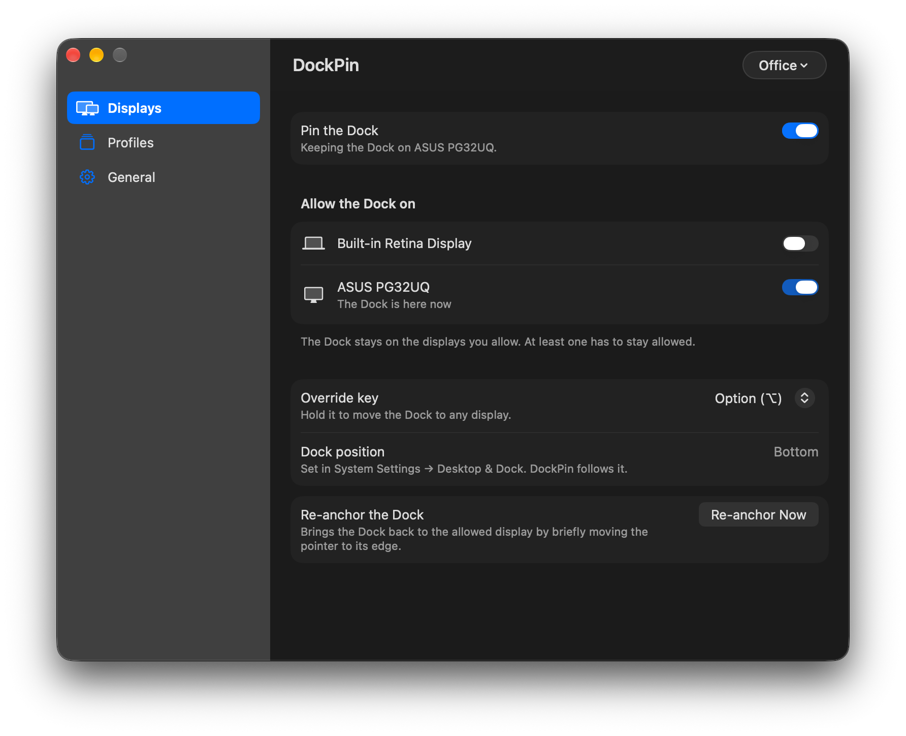
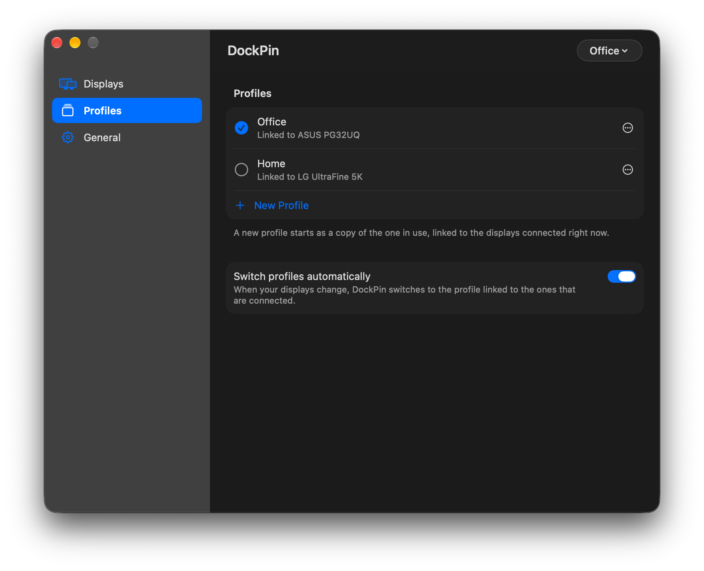
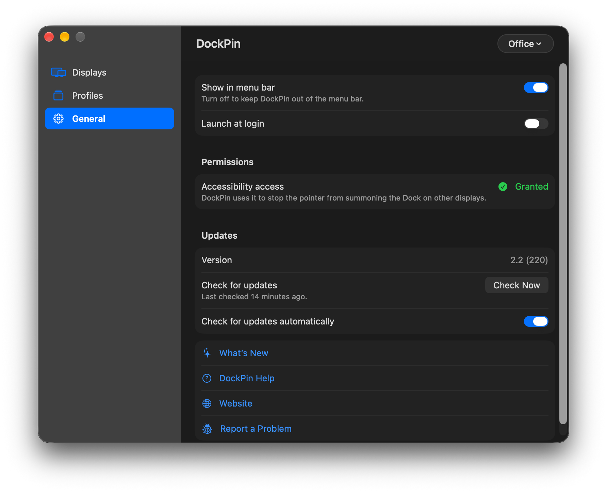
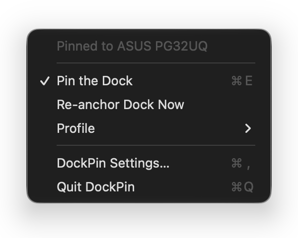

# DockPin

Keep your Mac's Dock on the display you choose, and stop it jumping to another screen when the pointer touches the edge.

<p align="center">
  
</p>

## What it does

On a Mac with several displays, macOS moves the Dock to whichever screen you push the pointer against. DockPin blocks that on the displays you haven't allowed, so the Dock stays where you put it.

- **Pin the Dock** to one or more displays, with the Dock on the left, bottom or right
- **Bring it back** after your Mac wakes, unlocks or changes displays
- **Override key**: hold Option, or any key you choose, to move the Dock freely for a moment
- **Profiles** for different desks, switched automatically when your displays change
- **Layout warnings** when your display arrangement leaves a display with no usable Dock edge
- **Stays out of the way**: a short menu in the menu bar, and the icon can be hidden
- **Updates itself**, and shows what's new before you install

<p align="center">
  
  
</p>

## Requirements

- A Mac with Apple silicon, running macOS 13 or later
- Two or more displays
- "Displays have separate Spaces" turned on (System Settings → Desktop & Dock → Mission Control)

## Install

1. Download `DockPin.zip` from the [latest release](https://github.com/green2grey/DockPin/releases/latest).
2. Unzip it and drag DockPin to your Applications folder.
3. Open it, and allow Accessibility access when macOS asks (System Settings → Privacy & Security → Accessibility).

DockPin is signed and notarized. There's more at [green2grey.github.io/DockPin](https://green2grey.github.io/DockPin/).

## Using it

1. Click the pin in the menu bar and choose **DockPin Settings…**
2. Under **Displays**, switch on the displays the Dock is allowed on.
3. Turn on **Pin the Dock**.

<p align="center">
  
</p>

The menu bar icon is a filled pin while the Dock is being held in place, and a warning triangle if DockPin has lost Accessibility access.

**Moving the Dock on purpose.** Hold the override key (Option unless you change it) and push the pointer against another display's Dock edge. DockPin leaves the Dock where you put it until your displays change or your Mac next wakes.

**Re-anchor Dock Now.** When exactly one connected display is allowed, this pulls the Dock back to it by briefly moving the pointer to that display's edge. DockPin does the same on its own after a wake, unlock or display change, but only if the Dock has actually ended up on the wrong display.

**Profiles.** A profile remembers which displays are allowed, your override key, and whether pinning is on. Each profile is linked to the external displays that were connected when you made it; with **Switch profiles automatically** on, DockPin changes profile when your displays change. Manage them under Settings → Profiles.

**Hiding the icon.** Turn off **Show in menu bar** under Settings → General. To get back to Settings, open DockPin again from Applications or Spotlight.

### When a display can't host the Dock

macOS only shows the Dock on an edge that has no other display beyond it. If the Dock is at the bottom and one monitor sits directly above another, the upper one has no free bottom edge, so the Dock can't live there. DockPin shows this next to the display in Settings. Moving the Dock to the left or right in System Settings, or shifting the displays in Arrangement, fixes it.

## Privacy

DockPin collects nothing: no analytics, no telemetry, no crash reports. Its only network use is checking for updates and downloading them, from GitHub. It needs Accessibility access to intercept pointer movement at the Dock edge, and uses it for nothing else.

## Build from source

You need Xcode. No signing certificate is required for a local build:

```
git clone https://github.com/green2grey/DockPin.git
cd DockPin
./build-dev.sh
open "build/DockPin Dev.app"
```

That makes `DockPin Dev`, a copy with its own settings that never checks for updates. Run the tests with `swift test`.

`build.sh` makes a release build and needs a Developer ID certificate; its header lists what else it expects.

## What's new

See the [changelog](CHANGELOG.md).

## License

[MIT](LICENSE)
